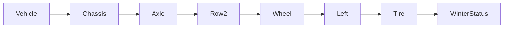

| | |
|---|---|
| Full qualified VSS Path: | `Vehicle.Chassis.Axle.Row2.Wheel.Left.Tire.WinterStatus` |
| Description: | Winter (cold-weather / snow) capability class of the tire currently fitted to this wheel. |
| Comment: | Describes the cold-weather grip capability of the fitted tire, which is the primary determinant of available traction on snow and ice. Modelled as an attribute because it is a property of the mounted equipment that changes only when tires are swapped, not a continuously varying measurement. WINTER indicates a dedicated winter / snow tire (e.g. carrying the three-peak-mountain-snowflake 3PMSF marking), designed for cold-weather rubber compounds and tread patterns that retain grip below approximately 7 degrees Celsius and on snow / ice. NON_WINTER covers summer and all-season tires alike: neither is a dedicated winter tire, and from a snow-traction standpoint both leave the vehicle with materially reduced cold-weather grip. The summer-vs-all-season distinction is a longevity / comfort property that does not change the snow-safety answer and is therefore intentionally not split here. UNKNOWN shall be used when the fitted-tire winter capability cannot be determined (e.g. no tire-identification data available, or input confidence below threshold). Primary consumers: driver-warning systems and navigation systems that adapt snow / mountain-pass routing and advisory thresholds to the grip the vehicle actually has. Combined with per-wheel placement, allows detection of mismatched or partially-fitted winter tire sets. Criteria for each state may be OEM-, market-, or jurisdiction-specific (e.g. national winter-tire regulations differ). Related to VSS issue #877 (Connected Safety signals).
 |

## Navigation



## Eclipse Leda: Usage Example

In [Eclipse Kuksa.VAL Databroker](https://github.com/eclipse/kuksa.val/tree/master/kuksa_databroker) CLI:


```bash
$ databroker-cli
sdv.databroker.v1 > connect
[connect] OK
sdv.databroker.v1 > get Vehicle.Chassis.Axle.Row2.Wheel.Left.Tire.WinterStatus
[get]  OK
Vehicle.Chassis.Axle.Row2.Wheel.Left.Tire.WinterStatus: ( NotAvailable )
sdv.databroker.v1 > set Vehicle.Chassis.Axle.Row2.Wheel.Left.Tire.WinterStatus UNKNOWN
[set]  OK
```

## Digital Auto: Playground

[playground.digital.auto](http://digital.auto) provides an in-browser, rapid prototyping environment utilizing the COVESA APIs for connected vehicles. 

| Vehicle Model | Direct link to Vehicle Signal |
|---|---|
| ACME Car (EV) v0.1 | [Vehicle.Chassis.Axle.Row2.Wheel.Left.Tire.WinterStatus](https://digitalauto.netlify.app/model/STLWzk1WyqVVLbfymb4f/cvi/list/Vehicle.Chassis.Axle.Row2.Wheel.Left.Tire.WinterStatus/) |

## Data Type & Unit

| | | |
|---|---|---|
| Path | `Vehicle.Chassis.Axle.Row2.Wheel.Left.Tire.WinterStatus` | [VSS: Addressing nodes](https://covesa.github.io/vehicle_signal_specification/rule_set/basics/) |
| Data type | `string` | [VSS: Datatypes](https://covesa.github.io/vehicle_signal_specification/rule_set/data_entry/data_types/) |
| Default value | `UNKNOWN` | [VSS: Sensors & Actuators](https://covesa.github.io/vehicle_signal_specification/rule_set/data_entry/sensor_actuator/) |
| Allowed values | `['UNKNOWN', 'NON_WINTER', 'WINTER']` | [VSS: Specifying allowed values](https://covesa.github.io/vehicle_signal_specification/rule_set/data_entry/allowed/) |


**Note:** The `string` datatype is a *character string*.


## Signal Information


The vehicle signal `Vehicle.Chassis.Axle.Row2.Wheel.Left.Tire.WinterStatus` is an **Attribute**.


The vehicle signal `Vehicle.Chassis.Axle.Row2.Wheel.Left.Tire.WinterStatus` is a **Signal**.


## Feedback

Do you think this Vehicle Signal specification needs enhancement? Do you want to discuss with experts? Try the following ressources to get in touch with the VSS community:

| | |
|---|---|
| Enhancement request | [Create COVESA GitHub Issue](https://github.com/COVESA/vehicle_signal_specification/issues/new?body=Please+describe+your+feedback&title=Signal+feedback+Vehicle.Chassis.Axle.Row2.Wheel.Left.Tire.WinterStatus) |
| Join COVESA | [www.covesa.global](https://www.covesa.global/join?src=sidebar) |
| Discuss VSS on Slack | [w3cauto.slack.com](http://w3cauto.slack.com/) |
| VSS Data Experts on Google Groups | [covesa.global data-expert-group](https://groups.google.com/a/covesa.global/g/data-expert-group) |

## About VSS

The [Vehicle Signal Specification](https://covesa.github.io/vehicle_signal_specification/) (VSS)
is an initiative by COVESA to define a syntax and a catalog for vehicle signals.
The source code and releases can be found in the [VSS github repository](https://github.com/COVESA/vehicle_signal_specification).

## Supported datatypes

The following is a list of VSS supported built-in datatypes:

Name       | Type                       | Min  | Max
:----------|:---------------------------|:-----|:---
uint8      | unsigned 8-bit integer     | 0    | 255
int8       | signed 8-bit integer       | -128 | 127
uint16     | unsigned 16-bit integer    |  0   | 65535
int16      | signed 16-bit integer      | -32768 | 32767
uint32     | unsigned 32-bit integer    | 0 | 4294967295
int32      | signed 32-bit integer      | -2147483648 | 2147483647
uint64     | unsigned 64-bit integer    | 0    | 2^64 - 1
int64      | signed 64-bit integer      | -2^63 | 2^63 - 1
boolean    | boolean value              | 0/false | 1/true
float      | floating point number      | -3.4e -38 | 3.4e 38
double     | double precision floating point number | -1.7e -300 | 1.7e 300
string     | character string           | n/a  | n/a

> Min, max and default values defined in a Vehicle Signal Specification must be in the supported range of the data type.
