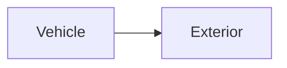

| | |
|---|---|
| Full qualified VSS Path: | `Vehicle.Exterior` |
| Description: | Information about exterior measured by vehicle. |

## Navigation

## Digital Auto: Playground

[playground.digital.auto](http://digital.auto) provides an in-browser, rapid prototyping environment utilizing the COVESA APIs for connected vehicles. 

| Vehicle Model | Direct link to Vehicle Signal |
|---|---|
| ACME Car (EV) v0.1 | [Vehicle.Exterior](https://digitalauto.netlify.app/model/STLWzk1WyqVVLbfymb4f/cvi/list/Vehicle.Exterior/) |

## Signal Information

The vehicle signal `Vehicle.Exterior` is a **Branch**.

## Children

This vehicle signal is a branch or structure and thus has sub-pages:

- [Vehicle.Exterior.AirPressure](airpressure/) (Atmospheric air pressure outside the vehicle.)
- [Vehicle.Exterior.AirQuality](airquality/) (Signals describing the composition of the ambient air outside the vehicle.)
- [Vehicle.Exterior.AirTemperature](airtemperature/) (Air temperature outside the vehicle.)
- [Vehicle.Exterior.Humidity](humidity/) (Relative humidity outside the vehicle. 0 = Dry, 100 = Air fully saturated.)
- [Vehicle.Exterior.LightIntensity](lightintensity/) (Light intensity outside the vehicle. 0 = No light detected, 100 = Fully lit.)
- [Vehicle.Exterior.PrecipitationIntensity](precipitationintensity/) (Precipitation intensity in millimeters per hour.)
- [Vehicle.Exterior.PrecipitationType](precipitationtype/) (Type of precipitation currently detected outside the vehicle.)
- [Vehicle.Exterior.RoadObstruction](roadobstruction/) (Type of road obstruction detected ahead of the vehicle.)
- [Vehicle.Exterior.RoadSurfaceCondition](roadsurfacecondition/) (Assessed condition of the road surface beneath or ahead of the vehicle.)
- [Vehicle.Exterior.RoadSurfaceContaminant](roadsurfacecontaminant/) (Detected non-weather surface contaminant on the road beneath or ahead of the vehicle.)
- [Vehicle.Exterior.RoadSurfaceTemperature](roadsurfacetemperature/) (Temperature of the road surface beneath or ahead of the vehicle.)
- [Vehicle.Exterior.VisibilityCondition](visibilitycondition/) (Assessed visibility condition outside the vehicle.)
- [Vehicle.Exterior.VisibilityDistance](visibilitydistance/) (Estimated visible distance ahead of the vehicle in current conditions.)
- [Vehicle.Exterior.WindDirection](winddirection/) (Wind direction in degrees (meteorological convention, 0 = North, 90 = East).)
- [Vehicle.Exterior.WindSpeed](windspeed/) (Surface wind speed outside the vehicle.)

## Feedback

Do you think this Vehicle Signal specification needs enhancement? Do you want to discuss with experts? Try the following ressources to get in touch with the VSS community:

| | |
|---|---|
| Enhancement request | [Create COVESA GitHub Issue](https://github.com/COVESA/vehicle_signal_specification/issues/new?body=Please+describe+your+feedback&title=Signal+feedback+Vehicle.Exterior) |
| Join COVESA | [www.covesa.global](https://www.covesa.global/join?src=sidebar) |
| Discuss VSS on Slack | [w3cauto.slack.com](http://w3cauto.slack.com/) |
| VSS Data Experts on Google Groups | [covesa.global data-expert-group](https://groups.google.com/a/covesa.global/g/data-expert-group) |

## About VSS

The [Vehicle Signal Specification](https://covesa.github.io/vehicle_signal_specification/) (VSS)
is an initiative by COVESA to define a syntax and a catalog for vehicle signals.
The source code and releases can be found in the [VSS github repository](https://github.com/COVESA/vehicle_signal_specification).

